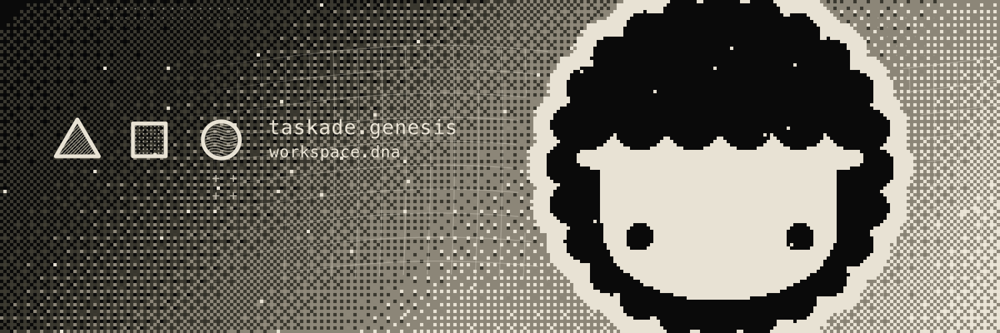

<p align="center">
  <a href="https://www.taskade.com"></a>
</p>

# Taskade

**Taskade is an AI-native workspace. Describe what you need, and Taskade Genesis builds a live app with its own data, AI agents and automations.**

Apps that remember. Agents that reason. Workflows that keep running.

Taskade EVE builds the app from your prompt. Projects hold the data, agents do the thinking, and automations run the work across 100+ integrations. Taskade hosts it all, so there is no backend to run and no deploy step.

<p align="center">
  <a href="https://www.taskade.com/create"></a>
</p>

**[Build an app from a prompt](https://www.taskade.com/create)** · **[Clone a ready-made app in the Taskade App Factory](https://www.taskade.com/apps)**

## Connect your AI agent

Paste this into your agent. It reads the skill, adds the hosted Taskade MCP server and asks you to sign in.

```text
Set up Taskade for me. Read and follow https://www.taskade.com/SKILL.md
```

Or add the hosted MCP server to any MCP client and sign in with your Taskade account:

```text
https://www.taskade.com/mcp
```

The hosted MCP server is part of every paid plan. Setup for each client is in the [MCP docs](https://www.taskade.com/docs/mcp).

## Repositories

| Repository | What it is | For |
|---|---|---|
| [`taskade`](https://github.com/taskade/taskade) | Public docs, comparisons and clone-ready App Kits. Not the product source. | Anyone who builds on Taskade |
| [`mcp`](https://github.com/taskade/mcp) | The agent plugin, the local MCP server and an OpenAPI-to-MCP code generator | Developers who connect an AI client |
| [`skills`](https://github.com/taskade/skills) | Agent skills: which Taskade tools to call, and what to check before the agent reports back | Anyone who works with an AI agent |
| [`docs`](https://github.com/taskade/docs) | Product guides and API docs. Fixes for typos and gaps are welcome. | Developers and docs readers |
| [`integrations`](https://github.com/taskade/integrations) | Taskade triggers and actions for automation platforms, built on the public API | Integration builders |
| [`cli`](https://github.com/taskade/cli) | Connects Claude Code, Cursor, Codex and VS Code to the hosted MCP server with sign-in (`plug`), and says why a connection fails (`doctor`). Run `npx @taskade/cli plug`. | Anyone who connects an AI client |
| [`taskade-sample-app`](https://github.com/taskade/taskade-sample-app) | A template for your own App Kit: projects, AI agents, automations and app UI as JSON files | App Kit builders |
| [`awesome-vibe-coding`](https://github.com/taskade/awesome-vibe-coding) | A curated guide to building software with plain language: tools, MCP servers and agent skills | Anyone who builds with AI |

More: [`tasks.md`](https://github.com/taskade/tasks.md), the build ledger spec for coding agents, and two parsers for date-time strings and URIs, [`temporal-parser`](https://github.com/taskade/temporal-parser) and [`uri-parser`](https://github.com/taskade/uri-parser).

## Links

[taskade.com](https://www.taskade.com) · [Developer docs](https://www.taskade.com/docs) · [MCP docs](https://www.taskade.com/docs/mcp) · [App gallery](https://www.taskade.com/apps) · [Changelog](https://www.taskade.com/changelog) · [Pricing](https://www.taskade.com/pricing) · [llms.txt](https://www.taskade.com/llms.txt)

- **Contribute:** issues and pull requests are welcome. Start with the [contributing guide](https://github.com/taskade/taskade/blob/main/CONTRIBUTING.md).
- **Security:** report a problem privately, never in a public issue. Read the [security policy](https://github.com/taskade/.github/blob/main/SECURITY.md).
- **Careers:** see the [open roles](https://www.taskade.com/jobs).
