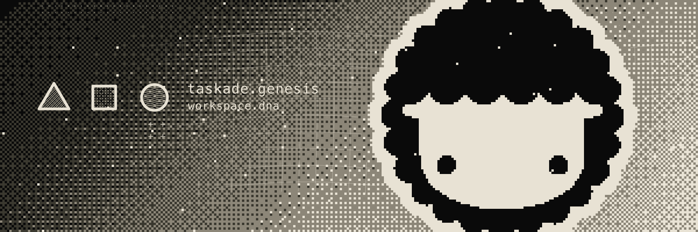

  

# Taskade

Taskade is an **AI app builder**: describe what you need and ship a live app with structure, data, and a shareable URL.

Build **AI agents** with tools and workspace context so they can research, update work, and run on your schedule.

Connect **automation** to your apps and projects—triggers, actions, and integrations that keep work moving without manual handoffs.

## Pinned repositories

Pin these on the [taskade](https://github.com/taskade) organization profile for the fastest path in:

| Repository | What it is |
|------------|------------|
| [`taskade/mcp`](https://github.com/taskade/mcp) | Hosted MCP server, Claude Code plugin, and MCP tooling |
| [`taskade/awesome-vibe-coding`](https://github.com/taskade/awesome-vibe-coding) | Curated vibe-coding tools and resources |
| [`taskade/docs`](https://github.com/taskade/docs) | Developer documentation and API guides |
| [`taskade/tasks.md`](https://github.com/taskade/tasks.md) | TASKS.md spec—the build ledger for coding agents |

## Start here

| Link | Use it for |
|------|------------|
| [taskade.com/create](https://www.taskade.com/create) | Build an app from a prompt |
| [taskade.com/SKILL.md](https://www.taskade.com/SKILL.md) | Teach an AI agent the Taskade tools |
| [taskade.com/mcp](https://www.taskade.com/mcp) | Connect external agents via MCP |
| [taskade.com/llms.txt](https://www.taskade.com/llms.txt) | Machine-readable index of docs and surfaces |

  <a href="https://www.taskade.com"><b>taskade.com</b></a>
  · <a href="https://www.taskade.com/docs"><b>Docs</b></a>
  · <a href="https://www.taskade.com/apps"><b>Apps</b></a>
  · <a href="https://www.taskade.com/pricing"><b>Pricing</b></a>

