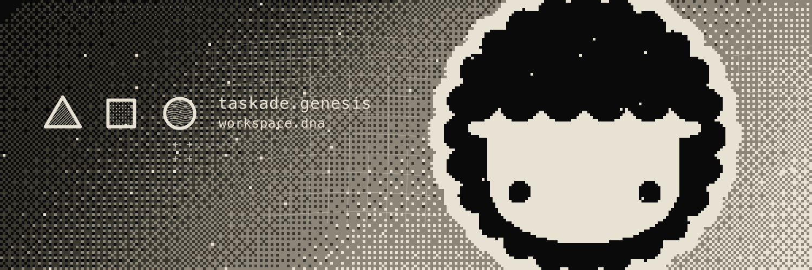

<p align="center">
  
</p>

<p align="center">
  <b>One prompt → one live app.</b> Taskade Genesis builds the data, AI agents, automations, and interface for you, all wired together. We call it Workspace DNA.
</p>

<p align="center">
  <a href="https://www.taskade.com"><b>Start building free at taskade.com →</b></a>
</p>

<p align="center">
  <b>For AI agents and developers:</b>
  <a href="#connect-your-ai-agent-mcp-server-and-claude-code-plugin">Claude Code plugin</a>
  · <a href="https://www.taskade.com/SKILL.md">SKILL.md</a>
  · <a href="https://www.taskade.com/mcp">Hosted MCP server</a>
  · <a href="https://www.taskade.com/api/documentation/v2">Public API</a>
  · <a href="https://www.taskade.com/llms.txt">llms.txt</a>
</p>

<p align="center">
  <a href="https://taskade.com"><b>Website</b></a>
  · <a href="https://www.taskade.com/docs"><b>Docs</b></a>
  · <a href="https://docs.taskade.com"><b>API</b></a>
  · <a href="https://www.taskade.com/apps"><b>Apps</b></a>
  · <a href="https://www.taskade.com/blog"><b>Blog</b></a>
  · <a href="https://www.taskade.com/learn"><b>Learn</b></a>
  · <a href="https://reddit.com/r/taskade"><b>Forum</b></a>
  · <a href="https://youtube.com/taskade"><b>YouTube</b></a>
  · <a href="https://x.com/taskade"><b>X</b></a>
</p>

<p align="center">
  <b>1M+ users</b> · <b>150,000+ apps</b> · <b>500K+ AI agents</b> · <b>1M+ automations</b>
  · <a href="https://www.taskade.com/reviews"><b>4.7/5</b> on Capterra and Product Hunt</a> · Backed by Y Combinator
  <br>
  Trusted by teams at <b>3M</b> · Nike · Tesla · Netflix · Airbnb · Disney · Adobe · ESPN
</p>

---

## See it

One prompt. A live app. Edit it. Ship it.

| Create | Edit | Publish |
|:---:|:---:|:---:|
|  |  |  |

---

## What is Taskade? The AI app builder for live apps

Taskade is the **execution layer for ideas**: a real-time workspace where AI agents build, automate, and run live applications from a single prompt. No code. No deploy step. No permission required.

```
   Describe what you want
          │
          ▼
  ┌───────────────┐       ┌───────────────┐       ┌───────────────┐
  │   GENERATE    │──────▶│    BUILD      │──────▶│     RUN       │
  │  AI reads     │       │  App assembles│       │  Live at a    │
  │  your intent  │       │  in real time │       │  shareable URL│
  └───────────────┘       └───────────────┘       └───────────────┘
```

### FAQ

| Question | Answer |
|----------|--------|
| **What is Taskade Genesis?** | An AI app builder. One prompt becomes a live app with memory, agents, and automations already wired. Start at [taskade.com/create](https://www.taskade.com/create). |
| **What is Workspace DNA?** | Memory + Intelligence + Execution: the loop every Taskade app runs on. |
| **Does Taskade have an MCP server?** | Yes. The hosted server is `https://www.taskade.com/mcp` (OAuth, paid plans). In Claude Code, install the `taskade` plugin. See [Connect your AI agent](#connect-your-ai-agent-mcp-server-and-claude-code-plugin) and [taskade/mcp](https://github.com/taskade/mcp). |
| **What's free vs Pro?** | Free is $0 with up to 3 apps and 2 workspace members. Pro is **$10/mo billed yearly** with unlimited live apps and 10 members. Full matrix: [taskade.com/pricing](https://www.taskade.com/pricing). |
| **Can I build a client portal from a prompt?** | Yes. Describe it; Genesis builds it live. Clone examples at [taskade.com/apps](https://www.taskade.com/apps). |
| **Where do I clone apps?** | [taskade.com/apps](https://www.taskade.com/apps). |
| **Where are developer docs?** | [taskade.com/docs](https://www.taskade.com/docs) · [Public API](https://www.taskade.com/api/documentation/v2) · [llms.txt](https://www.taskade.com/llms.txt) · [taskade.com/learn](https://www.taskade.com/learn) |

---

## Workspace DNA: projects, AI agents, and workflow automation

Memory feeds Intelligence. Intelligence triggers Execution. Execution writes back to Memory.

| Memory | Intelligence | Execution |
|:---:|:---:|:---:|
|  |  |  |
| Projects are live databases | Agents that reason and act | Workflows that run themselves |

| Train | Customize | Models |
|:---:|:---:|:---:|
|  |  |  |
| Your docs and projects | Tools and instructions | Frontier models from top AI labs |

---

## What you can build

Clone a finished kit, or describe one.

| Client portal | CRM | Storefront |
|:---:|:---:|:---:|
|  |  |  |

<details>
<summary><b>8 app categories at taskade.com/apps</b></summary>

| Category | Examples | How it works |
|----------|----------|--------------|
| [**Dashboards**](https://www.taskade.com/apps/dashboards) | KPI trackers, analytics, team metrics | Projects sync as live data |
| [**Tools**](https://www.taskade.com/apps/tools) | CRM views, inventory, admin panels | Agents keep data current |
| [**Websites**](https://www.taskade.com/apps/websites) | Landing pages, portfolios, status pages | Shareable URLs, custom domains |
| [**Projects**](https://www.taskade.com/apps/projects) | Task boards, roadmaps, sprint plans | Real-time collaboration |
| [**Workflows**](https://www.taskade.com/apps/workflows) | Lead routing, content pipelines | Durable automation across [100+ services](https://www.taskade.com/integrations) |
| [**Forms**](https://www.taskade.com/apps/forms) | Surveys, applications, feedback | Submissions land in live projects |
| [**Commerce**](https://www.taskade.com/apps/commerce) | Storefronts, orders, catalogs | End-to-end commerce |
| [**Quick Apps**](https://www.taskade.com/apps/quick-apps) | Calculators, converters, mini-tools | Instant single-purpose apps |

</details>

More kits and creator apps → [taskade.com/apps](https://www.taskade.com/apps)

---

## Connect your AI agent (MCP server and Claude Code plugin)

Connect Claude, ChatGPT, Cursor, VS Code, or any agent to your Taskade workspace. Sign in once. Nothing to host.

```bash
# Claude Code: the Taskade plugin (hosted MCP server + skills)
claude plugin marketplace add taskade/mcp
claude plugin install taskade@taskade

# Any agent: one skill file that teaches it the Taskade tools
npx skills add https://www.taskade.com/SKILL.md
```

**Hosted MCP server:** `https://www.taskade.com/mcp` · OAuth sign-in · Claude, ChatGPT, Cursor, VS Code · paid plans

| Your agent can | Taskade EVE does |
|----------------|------------------|
| Read and update projects, tasks, agents, and app files with the **hosted MCP tools** | Build and publish apps |
| Run a "When asked" automation and read its run history | Create and edit automations |

[Plugin + MCP server](https://github.com/taskade/mcp) · [SKILL.md](https://www.taskade.com/SKILL.md) · [llms.txt](https://www.taskade.com/llms.txt) · [Public API docs](https://www.taskade.com/api/documentation/v2)

---

## Open source repositories

Star the repos that are useful to you. The product source is private; these are the public tools.

| Repository | What it is |
|------------|------------|
| [`taskade/mcp`](https://github.com/taskade/mcp)  | Claude Code plugin, MCP server, and OpenAPI-to-MCP codegen |
| [`taskade/docs`](https://github.com/taskade/docs)  | API documentation and developer guides |
| [`taskade/taskade`](https://github.com/taskade/taskade)  | Public docs, honest comparisons, clone-ready App Kits |
| [`taskade/awesome-vibe-coding`](https://github.com/taskade/awesome-vibe-coding)  | Curated vibe-coding tools and resources |
| [`taskade/integrations`](https://github.com/taskade/integrations)  | Actions and triggers (Zapier, n8n) on the public API |
| [`taskade/temporal-parser`](https://github.com/taskade/temporal-parser)  | ISO 8601 / RFC 3339 / IXDTF lexer+parser |
| [`taskade/uri-parser`](https://github.com/taskade/uri-parser)  | RFC 3986 URI lexer+parser |
| [`taskade/taskade-sample-app`](https://github.com/taskade/taskade-sample-app)  | Workspace DNA sample Genesis app |

```bash
# Local MCP server (stdio), for clients without remote MCP. Set TASKADE_API_KEY first.
npx @taskade/mcp-server@latest

# REST API: create a project from markdown (token at taskade.com/settings/api)
curl -X POST https://www.taskade.com/api/v1/projects \
  -H "Authorization: Bearer YOUR_API_TOKEN" \
  -H "Content-Type: application/json" \
  -d '{"folderId": "FOLDER_ID", "contentType": "text/markdown", "content": "# My Project\n- First task"}'
```

| Resource | Link |
|----------|------|
| Developer docs | [taskade.com/docs](https://www.taskade.com/docs) |
| API reference | [taskade.com/api/documentation/v2](https://www.taskade.com/api/documentation/v2) · [docs.taskade.com](https://docs.taskade.com) |
| Learn Taskade | [taskade.com/learn](https://www.taskade.com/learn) |
| llms.txt | [taskade.com/llms.txt](https://www.taskade.com/llms.txt) |
| MCP server and plugin | [taskade.com/mcp](https://www.taskade.com/mcp) · [github.com/taskade/mcp](https://github.com/taskade/mcp) |
| Apps | [taskade.com/apps](https://www.taskade.com/apps) |
| Downloads | [taskade.com/downloads](https://www.taskade.com/downloads) |

<p align="center">
  Web · macOS · Windows · iOS · Android · Chrome · Firefox · Edge
  · <a href="https://www.taskade.com/downloads">Download Taskade</a>
</p>

---

## Pricing

| Free | Pro | Business | Max | Enterprise |
|:---:|:---:|:---:|:---:|:---:|
| **$0** | **$10/mo** | **$25/mo** | **$100/mo** | **$250/mo** |

*Billed yearly. Free includes 2 members, Pro includes 10, and Business and up include unlimited members. [Compare all plans →](https://www.taskade.com/pricing)*

---

<p align="center">
  <b>Software should be built by everyone.</b><br>
  Creation should be instant. Apps should be alive.<br><br>
  <a href="https://www.taskade.com/create"><b>Build without permission →</b></a>
</p>

```
╔══════════════════════════════════════════════════════════════════════════╗
║                                                                          ║
║   ████████  █████  ███████ ██   ██  █████  ██████  ███████               ║
║      ██    ██   ██ ██      ██  ██  ██   ██ ██   ██ ██                    ║
║      ██    ███████ ███████ █████   ███████ ██   ██ █████                 ║
║      ██    ██   ██      ██ ██  ██  ██   ██ ██   ██ ██                    ║
║      ██    ██   ██ ███████ ██   ██ ██   ██ ██████  ███████               ║
║                                                                          ║
║              One prompt → one app. Build without permission.             ║
║                                                                          ║
╚══════════════════════════════════════════════════════════════════════════╝
```

<p align="center">
  <a href="https://taskade.com">Website</a>
  · <a href="https://www.taskade.com/about">About</a>
  · <a href="https://www.taskade.com/docs">Docs</a>
  · <a href="https://www.taskade.com/apps">Apps</a>
  · <a href="https://reddit.com/r/taskade">Forum</a>
  · <a href="https://www.taskade.com/blog">Blog</a>
  · <a href="https://youtube.com/taskade">YouTube</a>
  · <a href="https://x.com/taskade">X</a>
  · <a href="https://www.taskade.com/contact">Contact</a>
</p>
